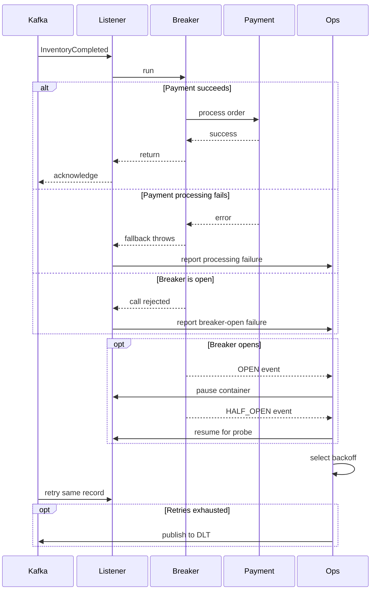

# Circuit breaker in the payments service

## What is a circuit breaker, and why use one?

Think of a circuit breaker as a pause button for calls to something that's having a bad day. It
watches how an operation is doing. If enough calls fail or take too long, the breaker opens and
stops sending more work to that operation for a while. After the wait, it lets a few calls through
as a test. If those calls succeed, it closes and normal traffic resumes.

The three states are:

- **Closed:** calls go through, and the breaker keeps track of how they do.
- **Open:** calls are rejected quickly; the operation is skipped.
- **Half-open:** a few test calls are allowed to see if things have recovered.

This helps when a slow or unavailable dependency could tie up request threads or consumer workers,
or cause failures to spread through the application. You'll often see breakers around HTTP calls,
gateways, databases, or message consumers that call another service.

A breaker doesn't fix the dependency or guarantee that work will eventually succeed. It also doesn't
replace timeouts, retries, bulkheads, or monitoring. A timeout limits how long one call can take; a
breaker looks at a run of calls and decides when to stop trying for a bit.

## Synchronous and asynchronous communication

With synchronous request/response communication, the caller waits for the dependency to answer. Wrap
the actual remote call in the breaker, then return a useful fallback or error if the call fails or
the breaker is open. Set a timeout too: otherwise, a stuck call can hold on to resources and make it
hard to judge whether the dependency is healthy.

It's also worth deciding which failures should count. A validation error or expected business
outcome usually shouldn't trip a breaker for a remote dependency. Be careful with retries as well.
If retry logic exists both inside and outside the breaker, one user request can turn into a lot of
slow calls.

With asynchronous messaging, a producer sends a record to a broker and a consumer handles it later.
A successful publish means the broker accepted the record according to the configured
acknowledgements. It doesn't mean the business operation in a downstream service succeeded.

For that reason, we put the breaker around the consumer's downstream work, and connect failures to
the message acknowledgement and retry behavior. If the consumer catches an error and returns as if
everything worked, the record may be acknowledged and disappear from the retry path. If it throws,
the framework can retry it or route it to a dead-letter destination, depending on its error-handler
setup.

Some things to keep in mind for a message consumer:

- **Retries and the breaker:** Kafka may deliver the same record again while the breaker is open.
  Keep retries bounded and make side effects safe to repeat. The breaker itself doesn't retry
  messages.
- **Offsets and ordering:** commits, concurrency, partitions, and pause/resume behavior all affect
  what gets processed next. Decide whether one failed record should hold up later records in its
  partition.
- **Breaker scope:** use a breaker for a meaningful dependency or operation. If unrelated event
  types share one breaker, one failing path can interfere with healthy work.
- **Fallback behavior:** keep the original error available and don't let a fallback pretend the
  operation succeeded. For work that must be preserved, retrying or dead-lettering is usually better
  than dropping the event.
- **Backpressure:** pausing consumption can help when a dependency is down, but check whether the
  listener also handles unrelated topics or work.
- **Duplicate delivery:** consumers should be able to handle replay safely. Kafka producer
  idempotence doesn't make a consumer's database writes or external side effects happen exactly
  once.

## How the payments service uses Kafka and a breaker

This service listens for customer, payment-method, inventory, and invoice events. In
`PaymentConsumer`, the `InventoryCompleted` handler calls `paymentService.process(order)` through
Spring Cloud Circuit Breaker's `CircuitBreakerFactory`. The other event handlers don't use this
breaker. In other words, the protected operation is payment processing after inventory has
completed.


### High-level sequence



`Ops` combines the Kafka error handler and the local breaker-listener controller to keep the sequence
narrow. The breaker waits 15 seconds before half-open; the breaker-open Kafka retry begins at 16
seconds.

The important part of the handler looks like this:

```java
CircuitBreaker breaker = circuitBreakerFactory.create("ecommerceCircuitBreakerGateway");
breaker.run(
    () -> {
      paymentService.process(event.orderDTO());
      return null;
    },
    throwable -> handlePaymentFallback(event, throwable));
```

If processing fails or the breaker is open, the fallback logs the order ID and the error, then
throws an exception with the original error attached. When Resilience4j rejected the call because
the breaker was open (`CallNotPermittedException`), the fallback wraps it in
`CircuitBreakerOpenException`. Other processing failures continue to use a general
`RuntimeException`. This distinction lets Kafka error handling recognize an open-breaker failure
separately from a failure that happened while processing a payment. Both exceptions still tell
Spring Kafka that processing failed, so the configured error handler can retry or recover the
record. The fallback doesn't quietly turn a failed payment into a successful acknowledgement.

### The breaker settings

The project includes `spring-cloud-starter-circuitbreaker-resilience4j`, so the code uses Spring
Cloud's circuit breaker API with Resilience4j providing the implementation. The named breaker is
configured in `src/main/resources/application.yml`:

```yaml
resilience4j:
  circuitbreaker:
    instances:
      ecommerceCircuitBreakerGateway:
        slidingWindowType: COUNT_BASED
        slidingWindowSize: 10
        failureRateThreshold: 50
        slowCallRateThreshold: 75
        slowCallDurationThreshold: 2000ms
        waitDurationInOpenState: 15000ms
        permittedNumberOfCallsInHalfOpenState: 3
        automaticTransitionFromOpenToHalfOpenEnabled: true
```

In plain terms, the breaker looks at the most recent ten calls. It opens if at least half fail, or
if at least 75% are slow. A call taking more than two seconds counts as slow. After 15 seconds in
the open state, the breaker moves to half-open and lets three calls through to test recovery.

These numbers should match the service's normal traffic and expected latency. With very little
traffic, it can take a while to collect ten calls. And if Kafka keeps redelivering one event, those
repeated attempts can all affect the breaker even though they represent the same logical piece of
work.

### Pausing and resuming the listener

`CircuitBreakerListenerController` listens for state changes on the same named breaker. When it
opens, the controller pauses the Kafka listener container identified by
`app.kafka.payments-event-listener-id`. When the breaker reaches half-open or closed, it resumes the
container. The idea is to stop feeding new records into the payment path while it's struggling, then
let work resume when the breaker starts testing recovery.

There's a tradeoff in the current setup: one listener container serves several topics, so pausing it
also pauses customer replication, payment-method replication, and invoice-failure handling. Those
handlers aren't protected by this breaker, but they stop too. If those event flows should keep
moving independently, put them on separate listener containers so the payment path can be paused on
its own.

This pause applies only to the listener container in this payments-service process. It does not
pause Kafka listeners in other services or stop them from publishing records. Those services keep
running, and Kafka retains records for this consumer group until this service resumes. When the
breaker enters **HALF_OPEN**, this controller resumes the container so payment events can act as
recovery probes; other event types can also be handled during that period. Once the breaker is
**CLOSED**, normal consumption continues. This is an intentional local backpressure choice, not a
system-wide pause.

Keep breaker state local to the service instance that measures the calls. Broadcasting a breaker
transition as a command to pause listeners in other services can give those services stale or
misleading state, especially when multiple payments-service instances have different breaker
states. Other services should protect their own calls to Payments with their own breakers. Use
business outcome events and workflow or saga state to coordinate business behavior; breaker
transitions can still be published for monitoring and alerting.

Pausing also affects throughput and partition progress, so it's worth watching how the listener
behaves under load. Consider whether pausing is needed in addition to the breaker, since the breaker
already stops the guarded call from running while open.

### Kafka retries and dead-letter handling

`KafkaConfig` sets the listener to record-level acknowledgement (`AckMode.RECORD`) and installs a
`DefaultErrorHandler` with a `DeadLetterPublishingRecoverer`. The handler now picks an exponential
backoff based on the exception. Ordinary processing failures start with the existing three-second
delay and double between retries, up to the configured maximum interval. A
`CircuitBreakerOpenException` uses its own longer exponential schedule: it starts at 16 seconds,
which is just beyond the breaker’s 15-second open interval, then increases up to 60 seconds. Both
schedules allow three retries by default before the recoverer sends the record to the dead-letter
topic.

The error handler resets its retry state when the exception type changes. That's useful here because
the first payment attempt can fail normally and open the breaker; the next delivery then fails with
`CircuitBreakerOpenException` and switches to the longer schedule. The retry limit applies to each
continuous exception type, so avoid rapidly alternating failure types without also setting an
overall delivery or retry-time limit.

The retry settings are under `app.kafka.retry` in `application.yml` and can be overridden with
environment variables. Keep `circuit-breaker-open.initial-interval-ms` longer than the breaker’s
`waitDurationInOpenState`; if the breaker open duration changes, update the retry delay too. This
gives the breaker time to move to half-open before Kafka tries that record again. It does not
guarantee recovery: if all retries fail, the record still goes to the dead-letter topic.

So the path is: payment processing fails, the fallback throws, and Spring Kafka's error handler
applies the matching exponential retry schedule. The fallback keeps breaker-open rejections
recognizable as `CircuitBreakerOpenException`; ordinary payment-processing failures continue to
use a general runtime failure.

The producer is also configured with `acks: all` and idempotence enabled. That helps with publishing
records to Kafka, but it doesn't make payment processing idempotent. Since a record may be delivered
more than once, payment processing should check an event or transaction ID before applying the same
side effect again. Also make sure the dead-letter topic exists and that someone is alerted when
records start accumulating there. A dead-letter topic preserves failed records for follow-up; it
doesn't resolve them automatically.

## A few things to watch in production

This implementation shows how a consumer-side breaker can work with Kafka retries and dead-letter
handling. Before depending on it in production, make sure the thresholds match real traffic, give
downstream calls their own timeouts, and avoid retrying longer than an event remains useful.

Keep an eye on breaker state changes, failure and slow-call rates, retry counts, consumer lag, and
dead-letter volume. The `PaymentConsumerTest` tests successful delegation and the fallback error
behavior, including the distinct breaker-open exception. `CircuitBreakerListenerControllerTest`
covers listener pause and resume when the breaker changes state. The latest `mvn verify` run passed
the project's JaCoCo line-coverage limits: 98.51% for the application bundle (with
`PaymentsServiceApplication` excluded) and 98.65% for the messaging package. Both configured limits
are 95%.
